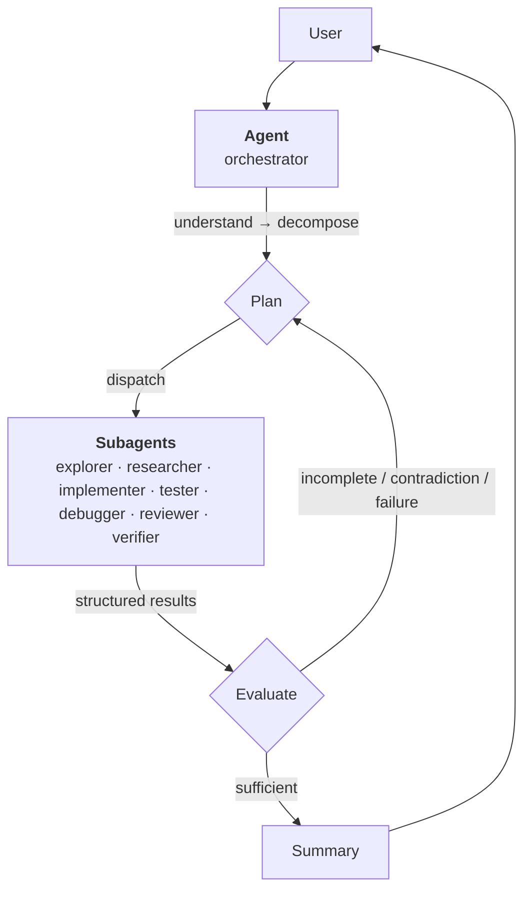

# Orchestrator

A set of skills to orchestrate workflows with subagents.

## Installation

Install the skills with the [`skills`](https://github.com/vercel-labs/skills) CLI:

```sh
# Core
skills add -g alpheusagents/orchestrator --skill orchestrator

# Adapter: OpenCode
skills add -g alpheusagents/orchestrator --skill orchestrator-adapter-opencode

# Add-on: test-driven development
skills add -g alpheusagents/orchestrator --skill orchestrator-addon-test-driven-development
```

Installing an add-on only makes it available. The orchestrator never activates one silently: it activates an add-on after an explicit request, or after a need-based offer that you accept.

## Usage

Trigger the skill by natural phrasing:

```md
work on it with sub-agents driven
```

```md
orchestrate an implementation for this project
```

Plans stay in the conversation until you ask to save one. The orchestrator creates a gitignored `.orchestrator/` workspace for reports and execution state; save the plan wherever you like. Scope or architecture changes to an approved plan need your approval.

## Architecture



## Workers

| Worker      | Capability                  | Permission         |
| ----------- | --------------------------- | ------------------ |
| explorer    | read-only inspection        | read-only          |
| researcher  | read-only, network research | read-only, network |
| implementer | code editing                | safe-edit          |
| tester      | test execution              | execution          |
| debugger    | failure diagnosis           | read-only          |
| reviewer    | independent review          | read-only          |
| verifier    | fix verification            | read-only          |

## License

This project is licensed under the terms of the MIT license.
